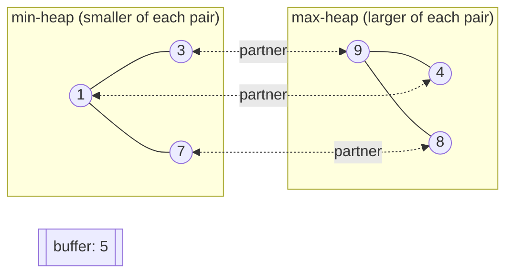

# Double-Ended Priority Queue

[](https://github.com/hsoni0303/Double_Ended_Priority_Queue/actions/workflows/tests.yml)


A **double-ended priority queue (DEPQ)** in pure Python. It gives you both the
minimum **and** the maximum in O(1), and removes either one in O(log n).

It uses the *dual-heap with correspondence* design: a min-heap and a max-heap
whose entries point at each other, so removing from one heap can delete the
matching entry from the other in logarithmic time.

```python
from depq import DoubleEndedPriorityQueue

q = DoubleEndedPriorityQueue([42, 7, 19, 3, 88, 25])
q.min(), q.max()   # (3, 88)
q.pop_min()        # 3
q.pop_max()        # 88
len(q)             # 4
```

## Why a DEPQ?

A normal heap answers only one question fast: either "what's the smallest?" or
"what's the largest?". Many problems need both:

- **Bounded top-k / sliding leaderboards**: keep the best *k* items and evict the worst.
- **Running median / interval scheduling**: work from both ends of a sorted set.
- **External sorting (quicksort-style partitioning on disk)**: a DEPQ holds the middle group of values while the smallest and largest are streamed out.

## How it works



Pairs `(1,4)`, `(3,9)` and `(7,8)` are split across the two heaps. The 7th element, `5`, waits in the buffer.

1. Elements are grouped into **pairs** `(small, large)`. The smaller one goes
   into the min-heap, the larger into the max-heap, and the two entries hold
   pointers to each other.
2. With an odd number of elements, the leftover one waits in a one-slot **buffer**.
3. **Invariant:** `small <= large` for every pair. So the global min is either
   the min-heap root or the buffer, and the global max is either the max-heap
   root or the buffer.
4. **`pop_min`**: pop the min-heap root, remove its partner from the max-heap
   with an O(log n) indexed delete, and push the partner back into the queue
   (it pairs up with the buffer if one is waiting).

Each heap is array-backed and every entry stores its own index (`IndexedHeap`).
That is what makes deleting from the middle of a heap O(log n) instead of O(n).

## Complexity

| Operation            | Time      |
|----------------------|-----------|
| `min()` / `max()`    | O(1)      |
| `push(x)`            | O(log n)  |
| `pop_min()` / `pop_max()` | O(log n) |
| `replace_min(x)`     | O(log n)  |
| Build from *n* items | O(n log n) |
| Space                | O(n)      |

## Project layout

```
src/depq/
  heap.py      # IndexedHeap: array heap with position tracking + arbitrary delete
  depq.py      # DoubleEndedPriorityQueue: dual heaps + buffer
tests/
  test_depq.py # unit tests + randomized tests against a sorted-list reference
examples/
  demo.py      # walkthrough, including a streaming top-k example
```

## Getting started

```bash
git clone git@github.com:hsoni0303/Double_Ended_Priority_Queue.git
cd Double_Ended_Priority_Queue
pip install -e ".[dev]"

pytest -q                 # run the test suite
python examples/demo.py   # see it in action
```

## API

| Method | Description |
|---|---|
| `DoubleEndedPriorityQueue(items=None)` | Create a queue, optionally from an iterable |
| `push(x)` | Insert an element |
| `min()` / `max()` | Peek at the smallest / largest element |
| `pop_min()` / `pop_max()` | Remove and return the smallest / largest element |
| `replace_min(x)` | Pop the min, then push `x` |
| `len(q)`, `bool(q)` | Size / non-empty check |

Calling an operation on an empty queue raises `IndexError`, just like `heapq` and `list.pop()`.

## Testing

Besides the unit tests for edge cases (empty queue, a single element,
duplicates), the suite runs **20 seeds × 500 random operations**. After every
step it checks the queue against a sorted Python list. CI runs the tests on
Python 3.9 and 3.12.
